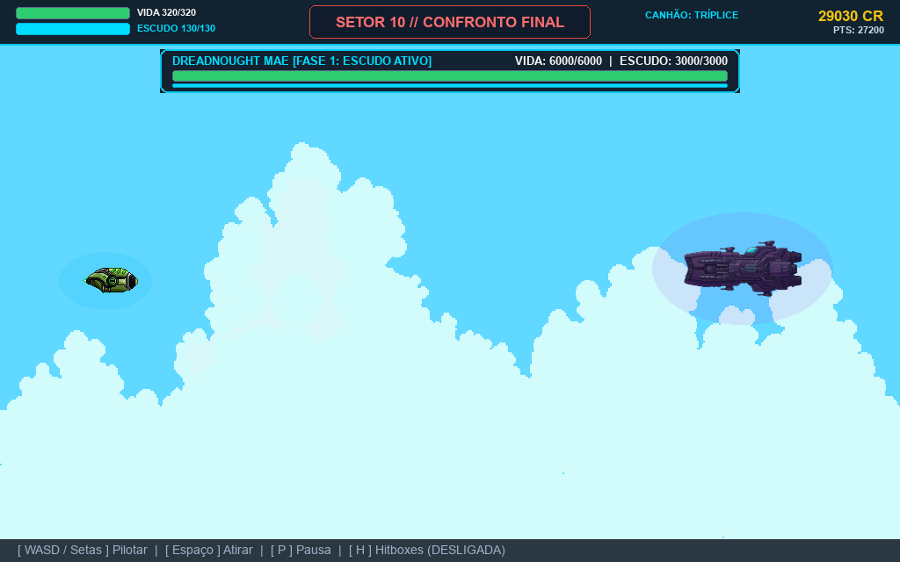
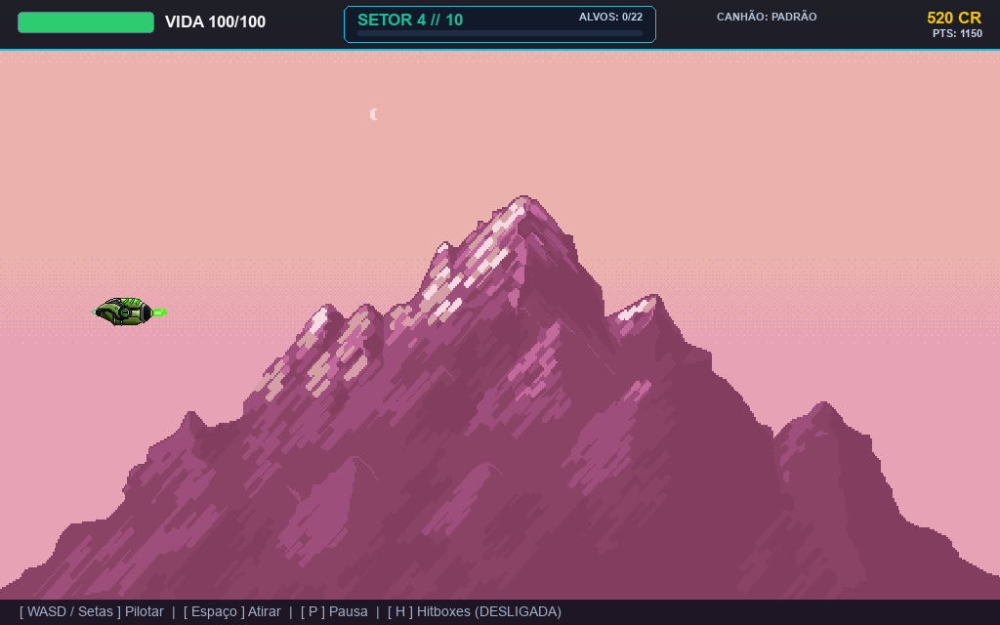
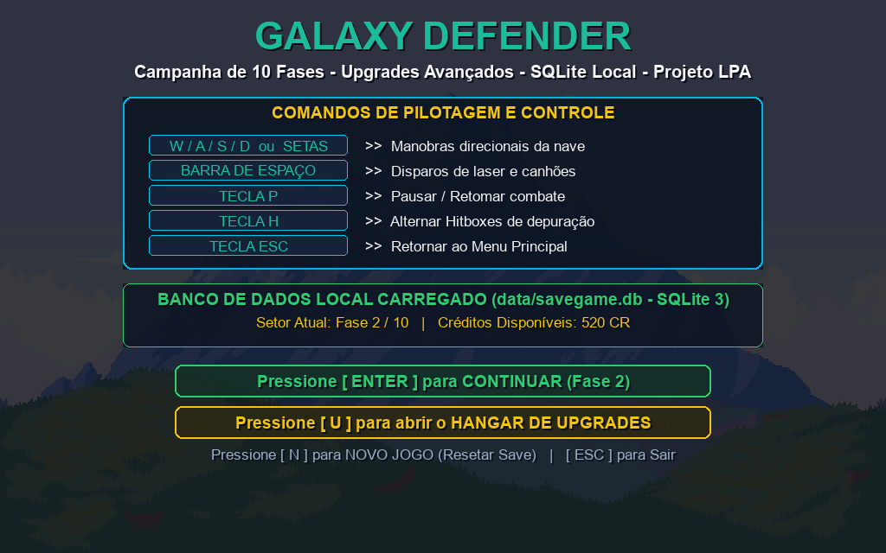
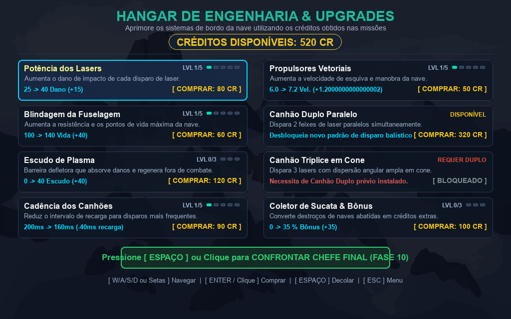

<div align="center">

# Galaxy Defender

**Combate espacial arcade em Python/Pygame — campanha de 10 setores, boss fight em 3 fases, hangar de upgrades e persistência SQLite local.**

[](#)
[](#)
[](#)
[](#)
[](#)

*Um clássico shoot 'em up espacial com gráficos neon, física de partículas, trilhas sonoras dinâmicas e progressão de hangar.*

[Visão Geral](#visão-geral) · [Screenshots](#screenshots) · [Funcionalidades](#funcionalidades) · [Controles](#controles) · [Instalação](#instalação) · [Estrutura do Projeto](#estrutura-do-projeto) · [FAQ](#faq)

</div>

---

## Visão Geral

**Galaxy Defender** é um jogo arcade 2D de combate espacial lateral (*side-scrolling shoot 'em up*) construído em **Python** com a biblioteca **Pygame**. O jogador pilota uma nave avançada através de 10 setores espaciais com densidade crescente de inimigos, velocidades progressivas e padrões de disparo balísticos, culminando em uma batalha contra o Dreadnought Mãe no Setor 10.

Entre as fases, o jogador pode acessar o **Hangar de Upgrades** para aprimorar blindagem, cadência de tiro, canhões duplos e ímã de créditos com persistência nativa em **SQLite**.

---

## Screenshots

<div align="center">
  <table>
    <tr>
      <td width="50%">
        <h3 align="center">Batalha Final — Dreadnought Boss</h3>
        
      </td>
      <td width="50%">
        <h3 align="center">Combate Espacial — Setor 4</h3>
        
      </td>
    </tr>
    <tr>
      <td width="50%">
        <h3 align="center">Menu Principal</h3>
        
      </td>
      <td width="50%">
        <h3 align="center">Hangar de Upgrades</h3>
        
      </td>
    </tr>
  </table>
</div>

---

## Funcionalidades

| Recurso | Nível | Descrição |
|---|:---:|---|
| **Campanha de 10 Fases** | ⭐⭐⭐⭐⭐ | 10 setores com curva progressiva de dificuldade, cenários dinâmicos e metas de eliminação. |
| **Boss Fight em 3 Fases** | ⭐⭐⭐⭐⭐ | Dreadnought com Escudo Ciano (Fase 1), Modo Fúria Amarelo (Fase 2) e Sobrecarga Crítica Vermelha (Fase 3). |
| **Hangar de Upgrades** | ⭐⭐⭐⭐⭐ | Sistema de compra com créditos para Danos, Cadência, Blindagem, Canhão Duplo e Ímã de Créditos. |
| **Persistência SQLite** | ⭐⭐⭐⭐⭐ | Banco de dados local `data/savegame.db` nativo sem necessidade de servidor externo (XAMPP/MySQL). |
| **Spritesheets & Animações** | ⭐⭐⭐⭐ | Animação por frames para propulsores da nave, esquadrões inimigos, tiros de plasma e explosões. |
| **Hitboxes Calibradas** | ⭐⭐⭐⭐⭐ | Máscaras de colisão e retângulos de colisão justos com modo de depuração visual em tempo real (`H`). |
| **HUD & Interface Neon** | ⭐⭐⭐⭐ | Barras de vida e escudo com transição de cor, contadores de créditos e painel de aviso de chefe. |
| **Áudio & Trilha Sonora** | ⭐⭐⭐⭐ | Músicas temáticas por setor e efeitos sonoros sincronizados para disparos, impactos e explosões. |

---

## Controles

| Tecla | Ação |
|---|---|
| `W`, `A`, `S`, `D` / `Setas` | Movimentação da nave nas 4 direções cardeais |
| `Espaço` | Disparo contínuo dos canhões de plasma/laser |
| `U` | Acessar o Hangar de Upgrades (entre as fases ou via menu) |
| `P` | Pausar / Despausar a partida |
| `H` | Ativar / Desativar visualizador de hitboxes em tempo real |
| `ESC` | Voltar ao Menu Principal / Sair |
| `Enter` | Iniciar / Confirmar |

---

## Instalação

### Opção 1 — Executável Windows (Recomendado)

Basta abrir o arquivo executável na pasta `bin/`:
- Windows: clique duplo em `bin/main.exe`

### Opção 2 — Executar com Python (Código-Fonte)

Certifique-se de ter o Python 3.10+ instalado:

```bash
# Instalar a biblioteca Pygame
pip install pygame

# Iniciar o jogo
python main.py
```

### Opção 3 — Compilar Executável com PyInstaller

```bash
pyinstaller --onefile --noconsole --distpath bin --name main main.py
```

---

## Estrutura do Projeto

```
GalaxyDefender/
├── asset/              ← Sprites, texturas, trilhas sonoras e efeitos de áudio
├── bin/                ← Executável final compilado para Windows (main.exe)
├── data/               ← Banco de dados local SQLite (savegame.db)
├── docs/
│   └── screenshots/    ← Capturas de tela e ilustrações do jogo
├── src/                ← Código-fonte modular da aplicação (Clean Architecture)
│   ├── application/    ← Orquestração do loop do jogo e lógica do hangar
│   ├── domain/         ← Entidades (jogador, inimigos, boss, lasers, fases)
│   ├── infrastructure/ ← Banco SQLite, configurações e carregador de assets
│   └── ui/             ← Menus, interface HUD, partículas e explosões
├── main.py             ← Ponto de entrada da aplicação
├── pyproject.toml      ← Configurações e metadados do projeto
└── README.md           ← Documentação completa
```

---

## FAQ

<details>
<summary><strong>Preciso de internet ou servidor externo para salvar o jogo?</strong></summary>

Não. O jogo utiliza **SQLite** nativo do Python, armazenando todo o progresso (fase atual, créditos, upgrades e recordes) no arquivo local `data/savegame.db`. Nenhuma conexão de rede é necessária.
</details>

<details>
<summary><strong>Como funciona o sistema de escudo e vida do Boss?</strong></summary>

O Dreadnought Mãe possui 3.000 pontos de Escudo de Energia e 6.000 pontos de Vida. Na Fase 1, todo dano recebido é absorvido pelo escudo ciano. Ao esgotar o escudo, o chefe entra na Fase 2 (Modo Fúria) com disparos acelerados. Abaixo de 2.000 de vida, ele entra na Fase 3 com sobrecarga crítica e saraivadas em arco.
</details>

<details>
<summary><strong>Como reiniciar o progresso do jogo do zero?</strong></summary>

Basta fechar o jogo e apagar o arquivo `data/savegame.db`. Ao iniciar novamente, o jogo criará um banco novo com os valores iniciais de campanha.
</details>

---

## Licença

Distribuído sob a licença MIT. Veja `LICENSE` para mais informações.
